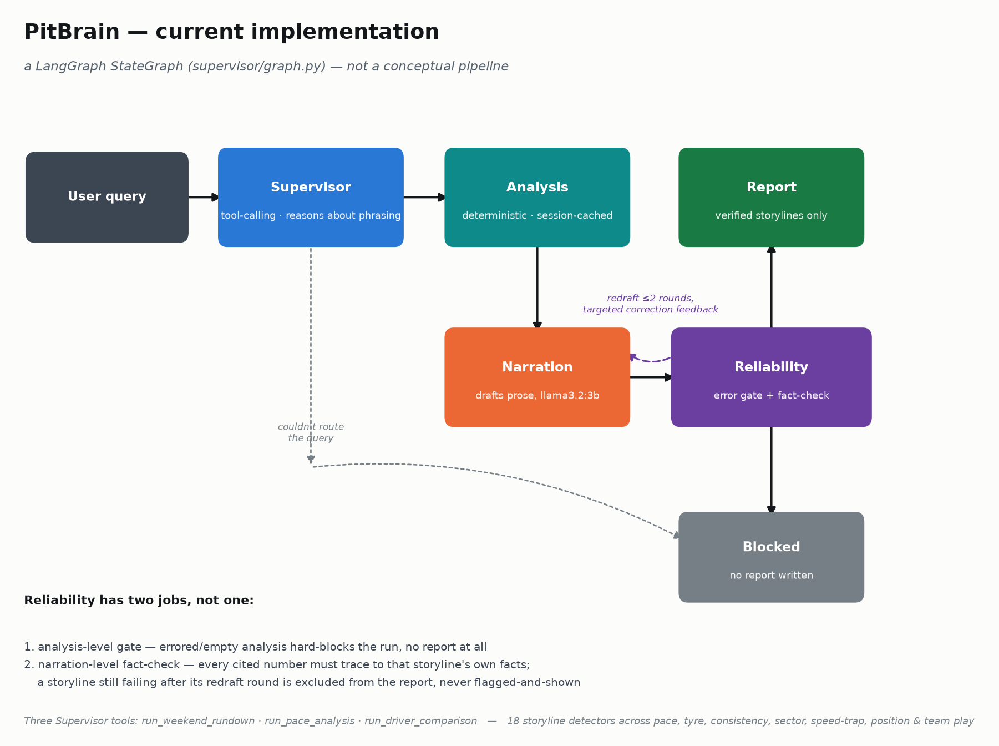
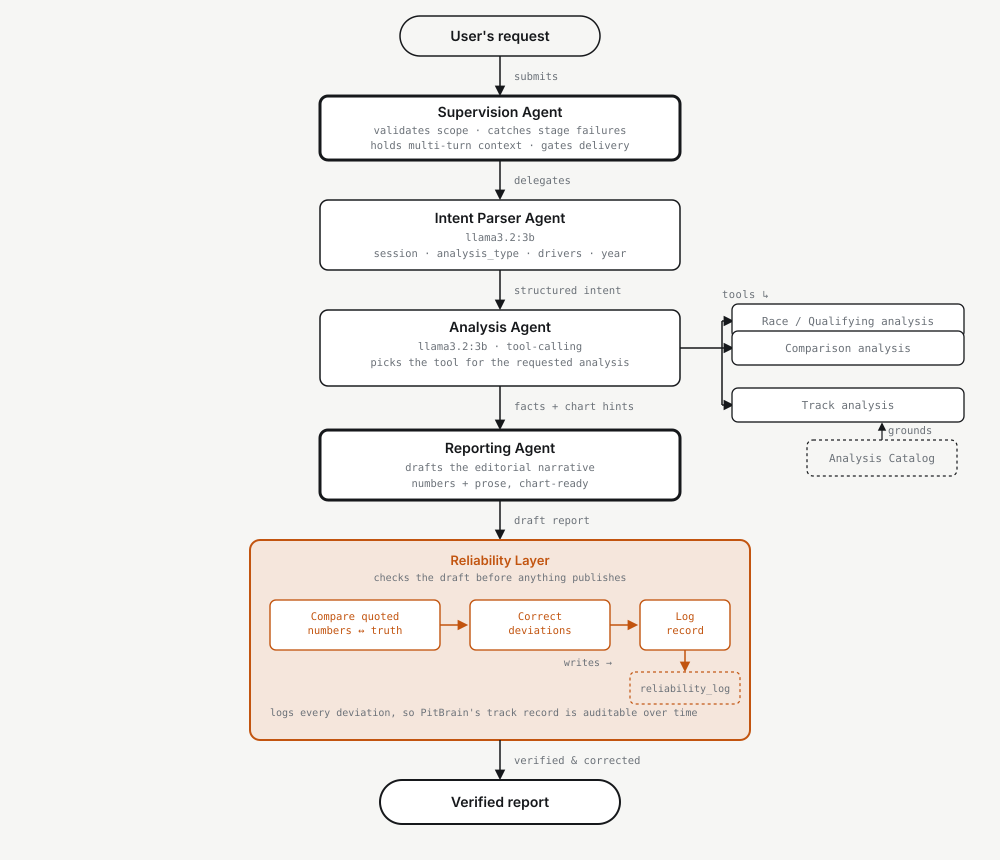

# PitBrain

A locally-run agentic system for analyst-grade F1 performance reporting, with built-in reliability safeguards.

## Architecture

A user query is parsed for intent (session, drivers, scope), which drives a data fetch and
slice (race and/or qualifying, the full field or a subset). From there, a deterministic
analysis stage computes the catalog's metrics and attaches a chart hint to each one — this is
the only stage allowed to touch the numbers. Its output fans out to two independent paths that
never talk to each other:

- **LLM narration** — turns each section's metrics into editorial copy, then passes through a
  **reliability layer** that verifies every number and driver attribution in that copy against
  the facts it was given, before anything is published.
- **Chart rendering** — turns each metric's `chart_hint` directly into a chart, with no LLM in
  the loop at all.

Both paths converge into the final report package.

| Stage | Color |
|---|---|
| Intent parser, data fetch and slice | Blue |
| Deterministic analysis, chart rendering | Teal |
| LLM narration | Coral |
| Reliability layer | Purple |

## Agent Pipeline

The diagram above describes the data flow; this is the current agent-level implementation of
the "intent parser → analysis" side of it, with a supervising agent added in front and the
reliability layer moved to a standalone stage after reporting rather than a step folded into
narration.

A request goes through five handoffs:

1. **Supervision Agent** — the entry point, and it earns that spot with four concrete jobs:
   validates the query is in scope before spending a downstream call, catches whatever a stage
   hands back (missing fields, an unresolved driver name) and decides retry vs. ask-the-user vs.
   abort, holds context across multi-turn follow-ups, and gates what actually reaches the user
   based on the Reliability Layer's verdict.
2. **Intent Parser Agent** (`llama3.2:3b`) — extracts `session` / `analysis_type` / `drivers` /
   `year` into structured JSON.
3. **Analysis Agent** (`llama3.2:3b`, tool-calling) — picks one of three tools grounded in the
   Analysis Catalog: race/qualifying analysis, driver comparison, or track-to-track comparison
   (not yet built).
4. **Reporting Agent** — drafts the editorial narrative from the analysis output.
5. **Reliability Layer** — compares every quoted number in the draft against ground truth,
   corrects deviations, and logs the correction to `reliability_log` so PitBrain's accuracy is an
   auditable track record, not a one-off console message.

`gemma2:2b` was dropped in favor of `llama3.2:3b` — Gemma's Ollama template doesn't support
tool-calling, which both the Intent Parser and Analysis agents rely on.